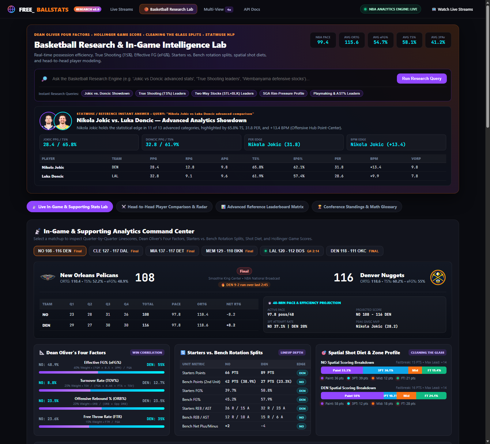
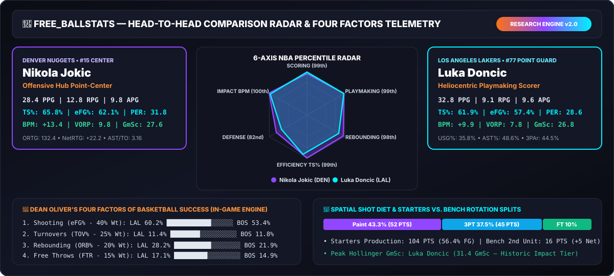
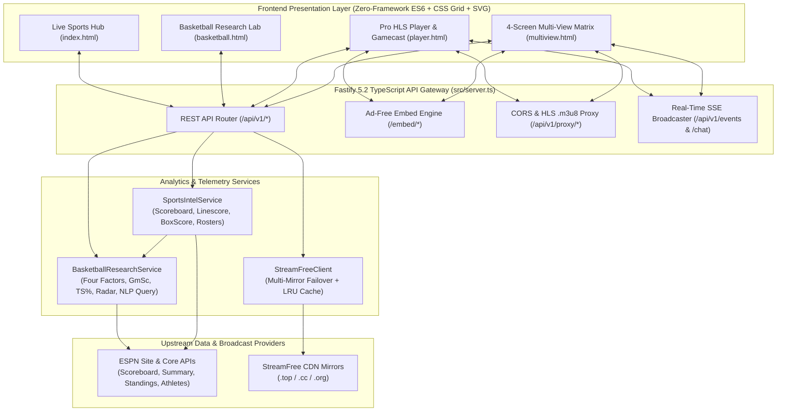

<div align="center">

# 🏀 Free_BallStats (`free_ballstats`)

### **Next-Generation Basketball Research Engine, In-Game Supporting Analytics Lab & Live Sports Streaming Platform**

[](https://github.com/rajmehta292/free_ballstats)
[](https://www.typescriptlang.org/)
[](https://fastify.dev/)
[](https://github.com/rajmehta292/free_ballstats)
[](./test/api.test.ts)

**Built for Basketball Analysts, Fans, Coaches, and Engineering Teams**  
*Synthesizing the analytical depth of **Basketball-Reference**, **Cleaning the Glass**, **NBA.com/Stats**, and **StatMuse** with the real-time broadcast experience of **ESPN Gamecast**.*

[Executive Overview](#-part-i--executive-overview-for-non-technical-audiences--basketball-fans) •
[Visual Product Tour](#-visual-product-tour--screenshots) •
[Basketball Analytics Guide](#-understanding-the-basketball-research-engine-plain-english-guide) •
[Mathematical Formulas](#-part-ii--mathematical--analytical-models-data-science-reference) •
[System Architecture](#-part-iii--technical-architecture-for-engineers--developers) •
[API Reference](#-complete-rest-api--sse-specification) •
[Quickstart](#-quickstart--deployment)

</div>

---

## 🌟 Part I — Executive Overview (For Non-Technical Audiences & Basketball Fans)

### What Problem Does **Free_BallStats** Solve?

When watching a live basketball game on traditional platforms, viewers are forced to choose between two disconnected worlds:
1. **Passive Video Streams** that show only the basic score and clock without explaining *why* a team is winning or losing.
2. **Static Reference Spreadsheets** (like Basketball-Reference or NBA.com/Stats) that are packed with deep numbers but require manual navigation away from the live game.

**`Free_BallStats`** unifies both worlds into a single, real-time command center:
- **During-the-Game Supporting Telemetry**: While watching any game, viewers immediately see **Quarter-by-Quarter Linescores**, **48-Minute Pace Projections**, **Starters vs. Bench Rotation Splits**, **Spatial Shot Diets** (Paint vs. 3-Point Perimeter vs. Mid-Range vs. Free Throws), and **Dean Oliver's Four Factors of Basketball Success**.
- **Dedicated Basketball Research Lab (`/basketball`)**: A standalone analytics workstation featuring a **StatMuse-style Natural Language Query Engine**, an interactive **Head-to-Head Player Comparison Lab with 6-Axis Percentile Radar Charts**, a **Sortable NBA Advanced Reference Matrix** (`PER`, `BPM`, `VORP`, `TS%`, `eFG%`, `USG%`, `GmSc`, `Stocks`), and **Live Conference Standings**.
- **Automated Coaching & Broadcast Insights**: Instead of forcing users to decipher raw tables, the engine automatically synthesizes plain-English insights explaining the key statistical edges driving the game in real time.

---

## 📸 Visual Product Tour & Screenshots

### 1. Dedicated Basketball Research & In-Game Analytics Lab (`/basketball.html`)
> Features the **StatMuse-Style Natural Language Search Bar**, **Live NBA Matchup Selector**, **Quarter-by-Quarter Linescore**, **Dean Oliver's Four Factors**, **Starters vs. Bench Unit Splits**, **Spatial Shot Diet**, and **Dual-Mode Advanced/Traditional Box Scores**.



---

### 2. Head-to-Head Player Comparison Radar, Four Factors & Spatial Shot Diet
> Interactive 6-axis percentile radar (`Scoring`, `Playmaking`, `Rebounding`, `Efficiency TS%`, `Defense`, `Impact BPM`), Dean Oliver's Four Factors telemetry, and Cleaning-the-Glass style spatial shot diet breakdown.



---

### 3. Live Broadcast Hub & Real-Time Sports Catalog (`/`)
> High-performance stream discovery hub with instant category filtering, live viewer telemetry, one-click access to the **Basketball Research Lab**, Quarter-by-Quarter Linescores, and multi-mirror failover.


---

### 4. Interactive OpenAPI / Swagger Developer Documentation (`/docs`)
> Self-documented REST API specification allowing engineers and data analysts to test every Basketball Research and Sports Intelligence endpoint directly in the browser.


---

## 🧠 Understanding the Basketball Research Engine (Plain-English Guide)

Whether you are a casual fan, a sports broadcaster, or a front-office analyst, `Free_BallStats` organizes basketball intelligence around four foundational pillars:

### Pillar 1: Dean Oliver's "Four Factors of Basketball Success"
Pioneered by basketball statistician Dean Oliver in *Basketball on Paper*, the **Four Factors** break down every basketball game into the four possession outcomes that determine who wins:

| Factor | Weight | Metric Used | Plain-English Meaning |
| :--- | :---: | :---: | :--- |
| **1. Shooting Efficiency** | **40%** | **Effective FG% (`eFG%`)** | How well a team shoots from the floor, giving 50% extra credit for 3-pointers because 3 points > 2 points. |
| **2. Ball Security** | **25%** | **Turnover Rate (`TOV%`)** | What percentage of a team's possessions end in a turnover before they even get a shot up. |
| **3. Second Chances** | **20%** | **Rebounding Rate (`ORB%` / `DRB%`)** | What percentage of missed shots a team recovers on offense (`ORB%`) to create extra scoring chances. |
| **4. Getting to the Line** | **15%** | **Free Throw Rate (`FTR`)** | How frequently a team attacks the rim to draw fouls and convert high-efficiency free throws relative to field goal attempts. |

### Pillar 2: During-the-Game Supporting Stats (Context Behind the Score)
- **Starters vs. Bench Rotation Splits**: Tracks points, rebounds, assists, field goal percentage, and net `+/-` separately for the starting five vs. the reserve rotation—revealing whether a lead was built by superstar starters or second-unit depth.
- **Spatial Shot Diet (Cleaning the Glass Style)**: Breaks down every team's scoring into four zones—**Paint Points**, **3-Point Perimeter Points**, **Mid-Range**, and **Free Throws**—plus **Fastbreak Points** and **Largest Lead**.
- **Pace & 48-Minute Score Projection**: Calculates the live possession rate per 48 minutes (`Pace`) and projects the final score based on current **Offensive Rating (`ORTG`)** and **Defensive Rating (`DRTG`)**.

### Pillar 3: Holistic Player Impact (Beyond Points Per Game)
- **True Shooting % (`TS%`)**: Measures a player's total scoring efficiency across 2-pointers, 3-pointers, and free throws combined. League average is `58.1%`; elite scorers exceed `62.0%`.
- **Hollinger Game Score (`GmSc`)**: Created by John Hollinger, `GmSc` condenses a player's entire box score line (`PTS`, `FGM/FGA`, `FTM/FTA`, `ORB`, `DRB`, `STL`, `AST`, `BLK`, `PF`, `TOV`) into a single number on a points-like scale:
  - `10.0` = Average NBA starter performance
  - `20.0+` = All-Star / Dominant performance
  - `30.0+` = Historic / MVP-caliber masterclass
- **Stocks (`STL + BLK`)**: Combined steals and blocks per game, quantifying two-way defensive disruption.

---

## 📐 Part II — Mathematical & Analytical Models (Data Science Reference)

All advanced metrics in [`src/services/basketball-research-service.ts`](./src/services/basketball-research-service.ts) are computed deterministically from play-by-play and box-score primitives using canonical NBA & Basketball-Reference formulas:

### 1. True Shooting Percentage ($\text{TS\%}$) & Effective Field Goal Percentage ($\text{eFG\%}$)
$$\text{TS\%} = \frac{\text{PTS}}{2 \times (\text{FGA} + 0.44 \times \text{FTA})} \times 100$$

$$\text{eFG\%} = \frac{\text{FGM} + 0.5 \times \text{3PM}}{\text{FGA}} \times 100$$

### 2. Possessions, Pace, & Offensive / Defensive Ratings ($\text{ORTG}, \text{DRTG}, \text{NetRTG}$)
$$\text{Possessions} = 0.96 \times (\text{FGA} + \text{TOV} + 0.44 \times \text{FTA} - \text{ORB})$$

$$\text{ORTG} = 100 \times \frac{\text{PTS}}{\text{Possessions}}, \quad \text{DRTG} = 100 \times \frac{\text{Opponent PTS}}{\text{Possessions}}, \quad \text{NetRTG} = \text{ORTG} - \text{DRTG}$$

### 3. Turnover Percentage ($\text{TOV\%}$), Offensive Rebound Percentage ($\text{ORB\%}$), & Free Throw Rate ($\text{FTR}$)
$$\text{TOV\%} = \frac{\text{TOV}}{\text{FGA} + 0.44 \times \text{FTA} + \text{TOV}} \times 100$$

$$\text{ORB\%} = \frac{\text{ORB}}{\text{ORB} + \text{Opponent DRB}} \times 100, \quad \text{FTR} = \frac{\text{FTM}}{\text{FGA}} \times 100$$

### 4. John Hollinger's Single-Game Productivity Score ($\text{GmSc}$)
$$\text{GmSc} = \text{PTS} + 0.4\cdot\text{FGM} - 0.7\cdot\text{FGA} - 0.4(\text{FTA} - \text{FTM}) + 0.7\cdot\text{ORB} + 0.3\cdot\text{DRB} + \text{STL} + 0.7\cdot\text{AST} + 0.7\cdot\text{BLK} - 0.4\cdot\text{PF} - \text{TOV}$$

### 5. Usage Percentage ($\text{USG\%}$)
$$\text{USG\%} = 100 \times \frac{(\text{FGA} + 0.44 \cdot \text{FTA} + \text{TOV}) \times (\text{Team MIN} / 5)}{\text{MIN} \times (\text{Team FGA} + 0.44 \cdot \text{Team FTA} + \text{Team TOV})}$$

---

## 🏗️ Part III — Technical Architecture (For Engineers & Developers)

### System Architecture Diagram



### Repository Structure

```text
free_ballstats/
├── src/
│   ├── server.ts                              # Fastify 5 application bootstrap, OpenAPI/Swagger, static & route registration
│   ├── config.ts                              # Environment configuration, mirror URLs, cache TTLs
│   ├── routes/
│   │   ├── api.ts                             # Core REST endpoints (/streams, /intel, /athlete, /basketball/*)
│   │   ├── embed.ts                           # Ad-free responsive video player embed endpoint
│   │   ├── proxy.ts                           # CORS-bypass HLS (.m3u8) manifest & segment proxy
│   │   ├── chat.ts                            # Real-time SSE live match banter & chat rooms
│   │   ├── export.ts                          # IPTV playlist (.m3u) & XMLTV EPG (.xml) generators
│   │   └── health.ts                          # System health & uptime diagnostics
│   ├── services/
│   │   ├── basketball-research-service.ts     # Basketball Research Engine (Four Factors, GmSc, TS%, Unit Splits, Shot Diet, Radar, NLP)
│   │   ├── sports-intel-service.ts            # Multi-sport Gamecast aggregator with ESPN live matching & NBA analytics injection
│   │   ├── streamfree-client.ts               # Multi-mirror stream discovery client with automatic failover & LRU caching
│   │   ├── custom-streams.ts                  # User-defined custom HLS/external stream persistence
│   │   └── sse-service.ts                     # Server-Sent Events connection manager
│   └── public/
│       ├── basketball.html                    # Dedicated Basketball Research & In-Game Analytics Lab UI
│       ├── index.html                         # Main Live Broadcast & Gamecast Watch Modal Hub
│       ├── player.html                        # Pro Player with HLS.js, Quality Switcher, PiP, Theater Mode & Live Gamecast
│       ├── multiview.html                     # 4-Stream Quad Split-Screen Matrix
│       ├── css/style.css                      # Unified dark-mode broadcast & analytics design system
│       └── js/
│           ├── basketball.js                  # Interactive controller for Basketball Research Lab & SVG Radar charts
│           ├── app.js                         # Main catalog, Watch Modal, Box Score, Rosters, and In-Game Analytics controller
│           └── multiview.js                   # Multi-screen synchronization controller
├── test/
│   └── api.test.ts                            # 19 automated integration tests covering all API & Basketball Research routes
├── docs/
│   └── screenshots/                           # High-resolution product screenshots for documentation
└── package.json                               # Project metadata (free_ballstats v2.0.0) & build scripts
```

---

## 🔌 Complete REST API & SSE Specification

### Basketball Research Engine Endpoints (`/api/v1/basketball/*`)

| Method | Endpoint | Description |
| :---: | :--- | :--- |
| `GET` | `/api/v1/basketball/hub` | Returns the full Basketball Research Lab payload: live/recent NBA games with Four Factors, ORTG/DRTG, unit splits, shot diet, conference standings, 13-player reference database, league benchmarks, and formula glossary. |
| `GET` | `/api/v1/basketball/game/:event_id` | Returns deep in-game analytics for a specific NBA matchup (`linescore`, `projectedPaceScore`, `team1Analytics`, `team2Analytics`, `playersTeam1`, `playersTeam2`, `mvpPerformer`, `inGameInsights`). |
| `GET` | `/api/v1/basketball/players` | Returns sortable and filterable NBA player profiles (`?sort=per\|bpm\|vorp\|ppg\|tspct\|efgpct\|gamescore\|usgpct\|netrtg\|stocks&position=ALL\|PG\|SG\|SF\|PF\|C&search=...`). |
| `GET` | `/api/v1/basketball/compare` | Head-to-head comparison between any two NBA players (`?p1=Nikola%20Jokic&p2=Luka%20Doncic`) with 6-axis radar percentiles and 13-metric edge detection. |
| `GET` | `/api/v1/basketball/query` | StatMuse-style Natural Language Research Query Engine (`?q=True%20Shooting%20leaders` or `?q=Jokic%20vs%20Doncic`). |

### Live Sports Intelligence & Streaming Endpoints

| Method | Endpoint | Description |
| :---: | :--- | :--- |
| `GET` | `/api/v1/intel/:stream_key` | Live Gamecast intelligence: Scoreboard, Quarter Linescore, Win Probability, Box Score (`Starters`, `Bench`, `Advanced Analytics`, `All Players`), Rosters, Leaders, Scoring Timeline, and News. |
| `GET` | `/api/v1/athlete/:sport/:league/:id` | Deep Athlete Bio Card: Physical measurements, draft/college info, and overview + advanced efficiency metrics. |
| `GET` | `/api/v1/streams` | List active and scheduled streams with `?category=`, `?search=`, `?live=true`, and `?sort=viewers\|time\|name`. |
| `GET` | `/api/v1/categories` | List all available sports categories (`basketball`, `football`, `soccer`, `hockey`, `baseball`, etc.). |
| `GET` | `/api/v1/proxy/m3u8?url=...` | CORS-enabled HLS manifest and segment proxy for direct `.m3u8` playback. |
| `GET` | `/api/v1/export/playlist.m3u` | Export all live streams as an M3U playlist for VLC, Kodi, or Tivimate. |

---

## 🚀 Quickstart & Deployment

### Prerequisites
- **Node.js** `>= 20.x`
- **npm** `>= 10.x`

### 1. Clone & Install
```bash
git clone https://github.com/rajmehta292/free_ballstats.git
cd free_ballstats
npm install
```

### 2. Build & Run Production Server
```bash
npm run build
npm start
```
The server starts on **`http://localhost:3000`**:
- 🏀 **Basketball Research Lab**: `http://localhost:3000/basketball.html` (or `http://localhost:3000/basketball`)
- 🎮 **Live Sports & Gamecast Hub**: `http://localhost:3000/`
- 📺 **Pro Player**: `http://localhost:3000/player.html`
- 🔲 **4-Screen Multi-View**: `http://localhost:3000/multiview.html`
- 📚 **Swagger API Docs**: `http://localhost:3000/docs`

### 3. Run Automated Test Suite
```bash
npm test
```
Runs all **19 integration & unit tests** in `test/api.test.ts` verifying health checks, stream catalog filtering, custom stream CRUD, IPTV/XMLTV exports, live Gamecast intelligence, Four Factors & Advanced Boxscore calculation, Head-to-Head Player Comparison, and Natural Language Research queries.

---

<div align="center">

**Engineered with precision for Basketball Research & Live Sports Intelligence — `Free_BallStats v2.0`**

</div>
