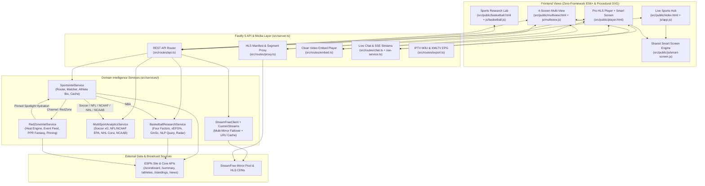
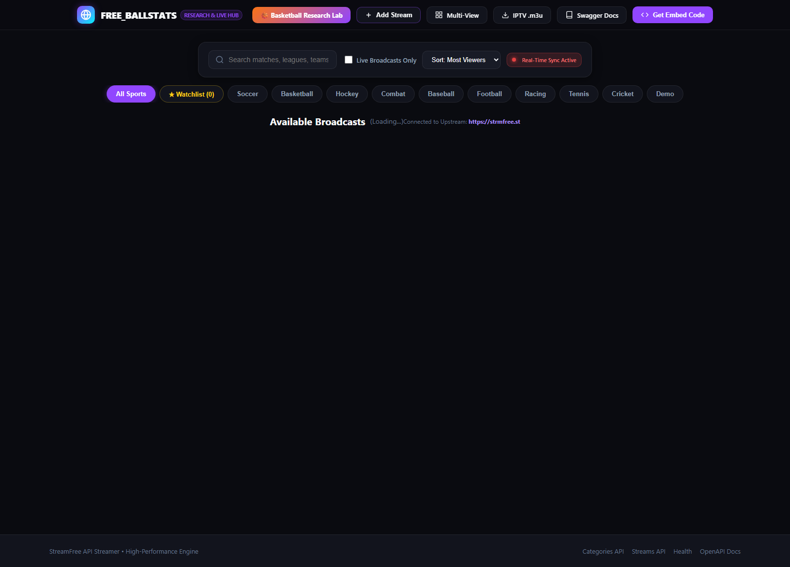
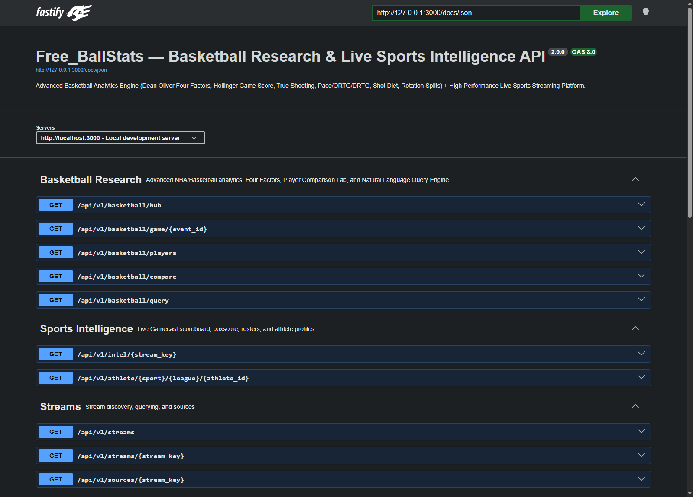

<div align="center">

# 📊 Free_BallStats (`free_ballstats`)

### **Full-Stack Smart Screen Live Sports Broadcast Canvas, Multi-Sport Analytics Engine & NFL RedZone Command Center**

[](https://github.com/rajmehta292/free_ballstats)
[](https://www.typescriptlang.org/)
[](https://fastify.dev/)
[](https://nodejs.org/)
[](https://github.com/rajmehta292/free_ballstats)
[](./test/api.test.ts)

**A unified real-time sports streaming & analytics platform built with TypeScript, Fastify 5, HLS.js, SSE, Custom SVG Data Visualizations, and Multi-Source ESPN Telemetry.**

[Project Highlights](#-resume--interview-overview) •
[Tech Stack](#-complete-technology-stack) •
[System Architecture](#-system-architecture--data-flow) •
[Multi-Sport & RedZone Design](#-sport-specific--broadcast-state-architecture) •
[Engineering Challenges Solved](#-real-world-engineering-issues-solved) •
[Math Models](#-mathematical--analytical-models) •
[API Reference](#-complete-rest--sse-api-specification) •
[Quickstart](#-quickstart--verification)

</div>

---

## 🎯 Resume & Interview Overview

**Free_BallStats** solves a core UX gap in modern live sports viewing: live video streams and deep statistical reference platforms exist in completely separate silos. Instead of forcing viewers to tab away from a live game to check box scores, play-by-play win probability, or advanced efficiency metrics, **Free_BallStats** renders a broadcast-grade **Smart Screen Companion Canvas** directly alongside and integrated into the video player—and adapts its data pipeline automatically depending on whether the user is watching **NBA Basketball**, **NFL RedZone (whip-around multi-game coverage)**, **Single-Game NFL/NCAAF**, **Soccer (UEFA / Premier League)**, **NHL Hockey**, or **College Basketball**.

### Key Engineering Accomplishments
- **Full-Stack TypeScript Broadcast Engine**: Architected a modular **Fastify 5** backend with **CORS-bypassing HLS `.m3u8` proxying**, **multi-mirror stream failover**, **LRU-cached ESPN data normalization**, **Server-Sent Events (SSE)** for real-time match chat/updates, and an interactive **OpenAPI 3 / Swagger** spec.
- **Responsive Zero-Occlusion Smart Screen UI (`smart-screen.js`)**: Engineered a dual-mode broadcast overlay featuring **L-Bar Squeeze-Back (`72% × 78%` scaled video + right/bottom telemetry rails)**, **Translucent Glass HUD**, **Auto-Triggered Smart Cards**, **Smart Fullscreen**, and a **Persistent Mini-Player Dock** linking the player to the standalone Analytics Research Lab.
- **NFL RedZone Many-to-One Command Center (`redzone-intel-service.ts`)**: Designed a real-time **Heat Ranking Engine (`0–100`)** across all 14 weekly NFL games combining Red Zone proximity, Goal-to-Go threats, 4th-quarter Witching Hour leverage, live Fantasy PPR pace scoring, Double-Box game pinning, a chronological TD/Turnover feed, and a client-side **anti-spoiler ring buffer (`0s / -15s / -30s`)**.
- **Sport-Authentic Multi-Sport Analytics & Pre/Live/Post State Machine**: Eliminated cross-sport metric/roster leakage and `0-0` pre-game math singularities across 6+ leagues, dynamically swapping 100% sport-native **SVG spatial surfaces** (NBA Half-Court, Soccer Pitch `xG`, NFL 100-Yard Turf `EPA`, NHL Ice Rink `Corsi/xGF`) and four analytical pillars per sport.
- **Automated Quality Gate (`24/24` Passing)**: Built an in-process HTTP route (`fastify.inject`) and deterministic analytics unit test suite using Node's native test runner (`node:test`) covering pre-game states, cross-sport isolation, RedZone Heat prioritization, player comparisons, and proxy/export pipelines.

---

## 🛠️ Complete Technology Stack

| Layer | Technologies & Libraries | Role in System |
| :--- | :--- | :--- |
| **Runtime & Language** | **Node.js (>= 20.x)**, **TypeScript 5.7** (`ESM`), **tsx** | Strictly typed backend services, ES module builds, hot-reload dev workflows, and direct TypeScript test execution. |
| **Web Server & API** | **Fastify 5.2**, `@fastify/cors`, `@fastify/static`, `@fastify/swagger`, `@fastify/swagger-ui` | High-throughput REST API gateway, static asset serving, and auto-generated OpenAPI `/docs` portal. |
| **Streaming & Media** | **HLS.js (`1.5.7`)**, Custom `.m3u8`/`.ts` CORS Proxy, Native PiP API, Fullscreen API | Adaptive bitrate HLS video playback with quality selection, Theater Mode, Picture-in-Picture, and CORS header rewriting for third-party manifests. |
| **Real-Time & Caching** | **Server-Sent Events (SSE)**, **`lru-cache` (`11.0.2`)**, **`dotenv`** | Multi-tier TTL caching (`12s` RedZone slate, `20s` gamecast intel, `1h` athlete bios) and push-based live match chat streams. |
| **Frontend Architecture** | **Vanilla ES6+ Modules**, **CSS Grid / Flexbox**, **Inline Procedural SVG**, **`localStorage`** | Zero-build, low-latency client UI (`index.html`, `player.html`, `basketball.html`, `multiview.html`) with shared reusable telemetry/SVG components (`smart-screen.js`). |
| **External Data APIs** | **ESPN Site API**, **ESPN Core / Athlete Statistics API**, **StreamFree Mirror Cluster** | Live scoreboards, play-by-play win probability, drives, box scores, season/career player splits, news, and redundant stream discovery. |
| **Testing & QA** | **`node:test`**, **`node:assert/strict`**, `fastify.inject` | Fast deterministic unit + integration verification across all routes and edge cases without requiring external server startup. |

---

## 🏗️ System Architecture & Data Flow

### High-Level Component Diagram



### How Components Communicate End-to-End
1. **Channel Detection & Routing ([sports-intel-service.ts](file:///C:/Projects/free_ballstats/src/services/sports-intel-service.ts))**:
   - When the frontend opens a stream (e.g., `/api/v1/intel/:stream_key` or `/api/v1/basketball/smart-hud/:stream_key`), `SportsIntelService` resolves the stream metadata and determines which intelligence pipeline owns the broadcast:
     - **Whip-Around Channel (`isRedZoneStream`)** → routes to [`RedZoneIntelService`](file:///C:/Projects/free_ballstats/src/services/redzone-intel-service.ts).
     - **NBA Basketball** → routes to ESPN NBA + [`BasketballResearchService`](file:///C:/Projects/free_ballstats/src/services/basketball-research-service.ts).
     - **Soccer / Single-Game NFL / NCAAF / NHL / NCAAB** → routes to ESPN sport-specific endpoint + [`MultiSportAnalyticsService`](file:///C:/Projects/free_ballstats/src/services/multi-sport-analytics-service.ts).
2. **Tiered Hydration & Caching**:
   - **Standard Game**: Fetches `/scoreboard` + `/summary?event={id}` + `/news`, normalized and cached in `LRUCache` for `20 seconds`.
   - **RedZone Multi-Game Slate**: Fetches ESPN `football/nfl/scoreboard` **once** (which already carries all 14 NFL games' live scores, `situation.isRedZone`, down/distance, `yardLine`, `lastPlay`, in-play win probability, and top `PASS/RUSH/REC` leaders), ranks all games via the Heat Engine, and performs **selective `/summary?event={id}` hydration only for the single Spotlight/Pinned game** to avoid N+1 API bursts.
3. **Shared Client Synchronization ([smart-screen.js](file:///C:/Projects/free_ballstats/src/public/js/smart-screen.js))**:
   - `SmartScreenController` powers the overlays inside **both** [player.html](file:///C:/Projects/free_ballstats/src/public/player.html) (Pro Player) and [index.html](file:///C:/Projects/free_ballstats/src/public/index.html) / [app.js](file:///C:/Projects/free_ballstats/src/public/js/app.js) (Modal Player).
   - Shared helper exports (`renderSvgSpatialMap`, `renderOnCourt5v5AndStints`, `renderWinProbWormChart`, `renderRedZoneSlateRibbon`, `renderRedZoneMultiGameSectionHtml`) guarantee identical analytics rendering above/over the video and inside the tabs below the video without duplicating logic.

---

## 🌐 Upstream APIs & External Integrations

| Provider | Endpoints Consumed | Data Extracted & Normalized |
| :--- | :--- | :--- |
| **ESPN Scoreboard API** | `https://site.api.espn.com/apis/site/v2/sports/{sport}/{league}/scoreboard` | Match status (`pre` / `in` / `post`), team names/abbreviations/logos/records, quarter/period linescores, NFL live `situation` (`isRedZone`, `down`, `distance`, `yardLine`, `possessionText`, timeouts, `lastPlay` + `probability`), and statistical leaders. |
| **ESPN Game Summary API** | `https://site.api.espn.com/apis/site/v2/sports/{sport}/{league}/summary?event={id}` | Deep player box scores (`Starters` vs `Bench`), team efficiency comparisons, full scoring timelines, drive descriptions, in-game win probability curves, betting odds/O/U, venue, and broadcast networks. |
| **ESPN Core & Athlete APIs** | `sports.core.api.espn.com/.../athletes/{id}` & `site.web.api.espn.com/.../athletes/{id}/statistics` | Player bio modal cards: height, weight, age, college, draft pedigree, jersey, headshot, and career/season stat splits. |
| **ESPN Standings & News** | `site.api.espn.com/apis/v2/sports/basketball/nba/standings` & `/sports/{sport}/{league}/news` | Eastern/Western conference standings + editorial matchup headlines and thumbnails. |
| **StreamFree API Mirrors** | Configurable primary + fallback mirrors (`streamfree-client.ts`) | Live sports stream catalog, categories, viewer counts, and `.m3u8` / embed sources with automatic health failover. |

---

## 🧩 Sport-Specific & Broadcast-State Architecture

Rather than forcing every sport into one generic template, **Free_BallStats** plans explicitly for each sport, broadcast format, and game lifecycle state:

### 1. NFL RedZone Command Center (`sportType: 'nfl_redzone'`)
Because **RedZone** is a *many-to-one* whip-around broadcast covering up to 10+ simultaneous games (and dynamically splitting into Single-Box, Double-Box, Quad-Box, and Witching Hour views), it operates on a dedicated architecture ([redzone-intel-service.ts](file:///C:/Projects/free_ballstats/src/services/redzone-intel-service.ts)):
- **RedZone Heat Ranking Engine (`0–100`)**: Scores every live NFL game on `situation.isRedZone` (`+32`), `Goal-to-Go` inside Opp 10 (`+18`), **Witching Hour** (`Q4/OT <= 7:00` one-score game, `+18`), `Two-Minute Drill` (`+8`), `4th Down` (`+10`), and recent scoring plays (`+12`) while demoting Halftime, Upcoming, and Final games.
- **Mini 100-Yard Drive Bar**: Parses ESPN `possessionText` (`"LAC 4"` vs `"SF 26"`) relative to possessing team to normalize ball location (`0%` own goal line → `80%–100%` shaded Red Zone).
- **Auto-Heat vs. Manual Pin & Double-Box (`A + B`)**: Defaults to the `#1` hottest game, or lets users click `Pin A` on any game pill/card (hydrating full box score, rosters, field map, and scoring timeline below the video) or `+2-Box` to inspect two simultaneous Double-Box matchups side-by-side.
- **Chronological Event Feed & Fantasy PPR Leaderboard**: Detects TDs, Red Zone entries, turnovers, FGs, and `20+ yd` explosive plays across polls with Win Probability swing badges, computes live PPR scores (`0.04/yd pass + 4 TD`, `1 PPR + 0.1/yd + 6 TD`), and supports a persistent `localStorage` **Fantasy Watchlist** (`fbs_rz_watchlist`).
- **Anti-Spoiler Broadcast Delay Buffer (`⚡ Live | ⏱️ -15s | ⏱️ -30s | 🙈 Masked`)**: Stores recent slate snapshots in `rzSnapshotBuffer` so viewers whose HLS stream trails real time by 15–30s never get spoiled before Scott Hanson cuts to the play.

### 2. Multi-Sport Analytical Framework ([multi-sport-analytics-service.ts](file:///C:/Projects/free_ballstats/src/services/multi-sport-analytics-service.ts))

| Sport / League | SVG Spatial Surface | Four Analytical Pillars | Unit / Lineup View |
| :--- | :--- | :--- | :--- |
| **NBA Basketball** (`nba`) | `basketball_halfcourt` (CourtOptix 6-Zone `xEFG%` Shot Chart) | Dean Oliver's Four Factors (`eFG%`, `TOV%`, `ORB%`, `FT Rate`) + `xEFG%` | On-Court 5v5 (`GmSc`, `+/-`, Fouls, Hot-Hand) & PopcornMachine Rotation Stints |
| **Soccer** (`soccer`) | `soccer_pitch` (Shot & Danger Zone `xG` Pitch Map) | Opta `xG`, StatsBomb `Field Tilt %`, `PPDA` Pressing Intensity, Big Chances / `xGOT` | Active Starting XI & Tactical Shape (`4-3-3`, `4-2-3-1`, etc.) |
| **NFL & College Football** (`nfl` / `ncaaf`) | `football_field` (100-Yd Field w/ Red Zones, TDs & Explosives) | `EPA / Play`, Success Rate %, Red Zone & 3rd Down Conv %, Explosive Play Rate | Active Offensive Personnel (`11`/`12`/`21` Grouping) & Key Skill Leaders |
| **NHL Hockey** (`nhl`) | `hockey_rink` (Slot, Point, Crease & High-Danger Shots) | 5v5 `Corsi (CF%)`, Expected Goals (`xGF%`), High-Danger Chances, Special Teams % | Active Forward Line & D-Pairings (`TOI`, `ixG`, `CF%`) |
| **College Basketball** (`ncaab`) | `basketball_halfcourt` | KenPom `AdjO/AdjD` Tempo-Free Four Factors | Projected / Active 5-Man Rotation |

### 3. Game Lifecycle State Machine (`'pre' | 'in' | 'post'`)
- **Pre-Game (`gameState === 'pre'`)**: Locks Leverage Index to `1.0x`, keeps team fouls at `0`, holds Linescores at `[0, 0, 0, 0] = 0`, shows `Season Scouting Avg` projected starting lineups + projected pace finals, and swaps Smart Cards to **Pre-Game Scouting Report**, **Head-to-Head Star Watch**, and **Four Factors Preview**.
- **In-Game (`gameState === 'in'`)**: Activates live Leverage Index, live Win Probability Worm curves, foul/bonus tracking, hot-hand/scoring-run alerts, and dynamic play-by-play shot/field plots.
- **Halftime & Post-Game (`gameState === 'post'`)**: Cleanly shifts into Final / Half recap state with full box score splits and zero fabricated live runs.

---

## 🐛 Real-World Engineering Issues Solved

These real production edge cases were surfaced during live-stream testing and systematically engineered out of the platform:

1. **Empty-String Substring Trap Locking RedZone onto One Game**
   - *Symptom*: Opening `"RedZone"` matched the very first NFL game on ESPN (`Las Vegas Raiders vs Seattle Seahawks`) and ignored the other 13 Sunday games.
   - *Root Cause*: Splitting `"RedZone"` on `vs|at` produced `t2Raw = ""`, and `'sea @ lv'.includes('')` evaluates to `true` in JavaScript.
   - *Fix*: Enforced `t1Raw.length >= 3` / `t2Raw.length >= 3` token checks in [sports-intel-service.ts](file:///C:/Projects/free_ballstats/src/services/sports-intel-service.ts) and introduced dedicated `isRedZoneStream()` detection routing to [`RedZoneIntelService`](file:///C:/Projects/free_ballstats/src/services/redzone-intel-service.ts).

2. **Pre-Game `0-0` Math Singularity (`5684.2 ORTG`, `0% eFG%`, and `Fouls: 2`)**
   - *Symptom*: Watching `LAL vs PHX` before tip-off during the national anthem displayed `5684.2 ORTG`, `0% eFG% with 82 paint points`, `28|26|27|27 = 108` on a `0-0` scoreboard, empty `ON-COURT 5` boxes, and `Fouls: 2`.
   - *Root Cause*: `fallbackScore || 108` evaluated `0` as falsy and injected `108` points against `~1.9` minimum possessions when FGA was `0`; similarly, `foulsInPeriod || 2` turned `0` fouls into `2` in `smart-screen.js`.
   - *Fix*: Separated `displayPts` (`0` in pre-game) from `baselinePts` (season scouting baseline), clamped `ortg` to `[94.0, 136.0]`, replaced `||` with `??` for foul counts, and built a 7-man projected NBA starter/bench database (`getDefaultTeamPlayers`) covering `PHX`, `LAL`, and all showcase teams so pre-game `Projected 5` panels are always populated.

3. **Home/Away Team Inversion (Swapped Records & Inverted Win Probabilities)**
   - *Symptom*: Comparing Houston Texans vs LA Chargers showed exchanged team records and inverted ESPN win probabilities (`4%` vs `96%` assigned to the wrong teams).
   - *Root Cause*: ESPN `competitors[0]` is always the *home* team regardless of stream title ordering (`Away @ Home` vs `Home vs Away`), and `summary.winprobability.homeWinPercentage` always represents the home team.
   - *Fix*: Matched `comp1` and `comp2` explicitly against `stream.team1` / `stream.team2` team names, and conditionally inverted `100 - rawHomePct` whenever `comp1.homeAway !== 'home'`.

4. **Cross-Sport Telemetry Leakage & Generic Placeholders**
   - *Symptom*: Soccer matches displayed NBA Smart Cards (`"Jaylen Brown Picked Up 3 Personal Fouls"`), and missing ESPN box scores showed `"QB1 #7 PG"` rows in NBA matchups.
   - *Root Cause*: Unmatched non-NBA streams fell back into the NBA showcase generator instead of a sport-native builder.
   - *Fix*: Added `MultiSportAnalyticsService` (`detectSportType`) with verified league rosters and strict `sportType` routing so Soccer, NFL, NCAAF, NHL, and NCAAB stay 100% isolated from NBA data.

5. **Real-Time API Spoiler Latency on Whip-Around Streams**
   - *Symptom*: Live ESPN polling runs ~15–45 seconds ahead of HLS video delivery, threatening to spoil touchdowns before viewers see them.
   - *Fix*: Implemented a rolling client snapshot ring buffer (`rzSnapshotBuffer`) with user-selectable `Live / -15s / -30s` sync offsets and a one-click `🙈 Masked` score-hiding mode.

---

## 📐 Mathematical & Analytical Models

All basketball efficiency telemetry in [`src/services/basketball-research-service.ts`](./src/services/basketball-research-service.ts) is computed deterministically from box-score and play-by-play inputs:

$$\text{TS\%} = \frac{\text{PTS}}{2 \times (\text{FGA} + 0.44 \times \text{FTA})} \times 100, \qquad \text{eFG\%} = \frac{\text{FGM} + 0.5 \times \text{3PM}}{\text{FGA}} \times 100$$

$$\text{Possessions} = 0.96 \times (\text{FGA} + \text{TOV} + 0.44 \times \text{FTA} - \text{ORB}), \qquad \text{ORTG} = 100 \times \frac{\text{PTS}}{\text{Possessions}}$$

$$\text{TOV\%} = \frac{\text{TOV}}{\text{FGA} + 0.44 \times \text{FTA} + \text{TOV}} \times 100, \qquad \text{ORB\%} = \frac{\text{ORB}}{\text{ORB} + \text{Opponent DRB}} \times 100$$

$$\text{GmSc} = \text{PTS} + 0.4\,\text{FGM} - 0.7\,\text{FGA} - 0.4(\text{FTA} - \text{FTM}) + 0.7\,\text{ORB} + 0.3\,\text{DRB} + \text{STL} + 0.7\,\text{AST} + 0.7\,\text{BLK} - 0.4\,\text{PF} - \text{TOV}$$

$$\text{xEFG\%} = \frac{\sum_{i=1}^{\text{FGA}} \text{xPTS}_i(\text{Zone}, \text{Distance})}{2 \times \text{FGA}} \times 100, \qquad \text{LI} = \frac{\mathbb{E}[|\Delta \text{WP}|_{\text{possession}}]}{\mathbb{E}[|\Delta \text{WP}|_{\text{league avg}}]}$$

---

## 📸 Visual Product Tour

| View | Description | Screenshot |
| :--- | :--- | :---: |
| **Basketball Research Lab (`/basketball`)** | StatMuse-style Natural Language Query bar, Four Factors, Starters vs Bench splits, Shot Diet, and Advanced Box Scores. |  |
| **6-Axis Player Comparison Radar** | Head-to-head percentile spider chart (`Scoring`, `Playmaking`, `Rebounding`, `TS%`, `Defense`, `BPM`) & Spatial Shot Diet architecture. |  |
| **Live Sports & Gamecast Hub (`/`)** | Responsive category filter, multi-mirror stream catalog, modal watch player with Smart Screen HUD & gamecast deck. |  |
| **Interactive Swagger Docs (`/docs`)** | Live OpenAPI 3 specification to inspect and execute every endpoint interactively in the browser. |  |

---

## 📂 Repository Structure

```text
free_ballstats/
├── src/
│   ├── server.ts                              # Fastify 5 app factory (buildServer), Swagger/OpenAPI, static assets & routes
│   ├── config.ts                              # Env config, StreamFree mirror pool, LRU TTL constants
│   ├── types/stream.ts                        # Shared TypeScript interfaces for streams & sources
│   ├── routes/
│   │   ├── api.ts                             # Core REST endpoints (/streams, /intel, /redzone/intel, /basketball/*, /athlete/*)
│   │   ├── embed.ts                           # Clean responsive video embed wrapper
│   │   ├── proxy.ts                           # CORS-enabled HLS (.m3u8) manifest & segment proxy
│   │   ├── chat.ts                            # Real-time match chat & SSE subscription endpoints
│   │   ├── export.ts                          # IPTV M3U & XMLTV EPG playlist exporters
│   │   └── health.ts                          # Server uptime & health diagnostics
│   ├── services/
│   │   ├── redzone-intel-service.ts           # NFL RedZone Multi-Game Heat Engine, Event Feed, PPR Fantasy & Spotlight selector
│   │   ├── sports-intel-service.ts            # Unified ESPN router, name matcher, selective summary hydration & athlete profiles
│   │   ├── basketball-research-service.ts     # NBA Four Factors, xEFG%, GmSc, projected starters, Player Compare & NLP Query Engine
│   │   ├── multi-sport-analytics-service.ts   # Sport-authentic analytics for Soccer, NFL, NCAAF, NHL & NCAAB
│   │   ├── streamfree-client.ts               # Multi-mirror stream discovery with failover & caching
│   │   ├── cache-service.ts                   # Shared caching utilities
│   │   ├── chat-service.ts                    # Match chat room state management
│   │   ├── custom-streams.ts                  # User-defined custom stream CRUD store
│   │   └── sse-service.ts                     # Server-Sent Events connection broadcaster
│   └── public/
│       ├── index.html & js/app.js             # Live Sports Hub, Category filters, Watch Modal & Gamecast controller
│       ├── player.html                        # Pro HLS Player (Quality selector, Theater, PiP, Smart Screen HUD & Gamecast tabs)
│       ├── basketball.html & js/basketball.js # Standalone Sports Research Lab & Persistent Mini-Player Dock
│       ├── multiview.html & js/multiview.js   # 4-Screen Quad Split-Screen Matrix
│       ├── js/smart-screen.js                 # Shared Smart Screen Controller (L-Bar, Glass HUD, Smart Cards, SVG surfaces & RedZone UI)
│       └── css/style.css                      # Unified dark-mode broadcast design system & responsive layouts
├── test/
│   └── api.test.ts                            # 24 automated unit & HTTP injection tests covering all modules
├── docs/screenshots/                          # Product UI screenshots & architecture visuals
└── package.json                               # Dependencies & TypeScript/test scripts
```

---

## 🔌 Complete REST & SSE API Specification

### RedZone & Multi-Sport Live Intelligence
| Method | Endpoint | Description |
| :---: | :--- | :--- |
| `GET` | `/api/v1/redzone/intel` | **NFL RedZone Multi-Game Slate**: Returns all NFL games ranked by RedZone Heat (`0–100`), rolling TD/Turnover/RedZone Event Feed, Fantasy PPR leaderboard, and hydrated spotlight intel. Supports `?pinnedEventId=` & `?pinnedB=`. |
| `GET` | `/api/v1/intel/:stream_key` | Unified live Gamecast intel for any stream (Scoreboard, Linescore, Win Probability, Box Score, Rosters, Leaders, Scoring Timeline, News, plus `redzoneIntel` when watching RedZone). |
| `GET` | `/api/v1/basketball/smart-hud/:stream_key` | Smart Screen L-Bar & Glass HUD payload supporting `basketball`, `nfl_redzone`, `soccer`, `nfl`, `ncaaf`, `hockey`, and `ncaab`. |
| `GET` | `/api/v1/athlete/:sport/:league/:athlete_id` | Athlete bio card, physical profile, college/draft info, and statistical splits. |

### Basketball Research Engine (`/api/v1/basketball/*`)
| Method | Endpoint | Description |
| :---: | :--- | :--- |
| `GET` | `/api/v1/basketball/hub` | Full NBA Research Lab dataset + Multi-Sport showcase payload (`Standings`, `Players`, `Benchmarks`, `Glossary`, `Games`). |
| `GET` | `/api/v1/basketball/game/:event_id` | Deep single-game NBA breakdown (`Four Factors`, `Shot Chart`, `5v5 Lineup`, `Stint Flow`, `Win Prob Worm`, `Synergy PPP`). |
| `GET` | `/api/v1/basketball/players` | Filterable & sortable NBA player matrix (`?sort=per\|bpm\|vorp\|ppg\|tspct\|efgpct\|gamescore\|usgpct\|netrtg\|stocks&position=&search=`). |
| `GET` | `/api/v1/basketball/compare` | Head-to-head 6-axis radar percentiles & 13-metric comparison (`?p1=&p2=`). |
| `GET` | `/api/v1/basketball/query` | StatMuse-style Natural Language Query engine (`?q=True Shooting leaders`). |

### Streaming, Proxy, Chat & Export
| Method | Endpoint | Description |
| :---: | :--- | :--- |
| `GET` | `/api/v1/streams` / `/api/v1/categories` | Stream catalog discovery (`?category=`, `?search=`, `?live=true`, `?sort=viewers\|time\|name`). |
| `POST`/`DELETE` | `/api/v1/custom-streams` | Add or remove custom HLS `.m3u8` / embed streams. |
| `GET` | `/api/v1/proxy/m3u8?url=...` | CORS-enabled HLS manifest & video segment proxy. |
| `GET` | `/api/v1/chat/:room` & `/api/v1/events` | Real-time SSE endpoints for match chat & live broadcast events. |
| `GET` | `/api/v1/export/playlist.m3u` & `/epg.xml` | IPTV M3U & XMLTV EPG guide exports + `/health` diagnostics. |

---

## 🚀 Quickstart & Verification

### Prerequisites
- **Node.js** `>= 20.x`
- **npm** `>= 10.x`

### 1. Install, Build & Run
```bash
git clone https://github.com/rajmehta292/free_ballstats.git
cd free_ballstats
npm install
npm run build
npm start
```
The platform launches at **`http://localhost:3000`**:
- 🎮 **Live Sports Hub**: `http://localhost:3000/`
- 📺 **Pro Player (Smart Screen + RedZone Command Center)**: `http://localhost:3000/player.html?key=redzone&category=football`
- 🏀 **Basketball & Sports Research Lab**: `http://localhost:3000/basketball.html`
- 🔲 **4-Screen Multi-View Matrix**: `http://localhost:3000/multiview.html`
- 📚 **Swagger / OpenAPI Docs**: `http://localhost:3000/docs`

### 2. Run Automated Tests
```bash
npm test
```
Executes all **24 tests** in [`test/api.test.ts`](./test/api.test.ts), verifying stream CRUD & filtering, HLS proxying, IPTV/XMLTV exports, multi-sport isolation (`Soccer`, `NFL`, `NCAAF`, `NHL`, `NCAAB`), NBA `0-0` pre-game boundary handling, RedZone Heat Engine ranking & Fantasy PPR telemetry, and `/api/v1/redzone/intel` routes.

---

<div align="center">

**Engineered by [@rajmehta292](https://github.com/rajmehta292) — Built for High-Leverage Live Sports Telemetry & Broadcast UX (`Free_BallStats v3.1`)**

</div>
